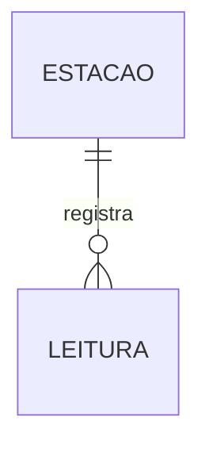
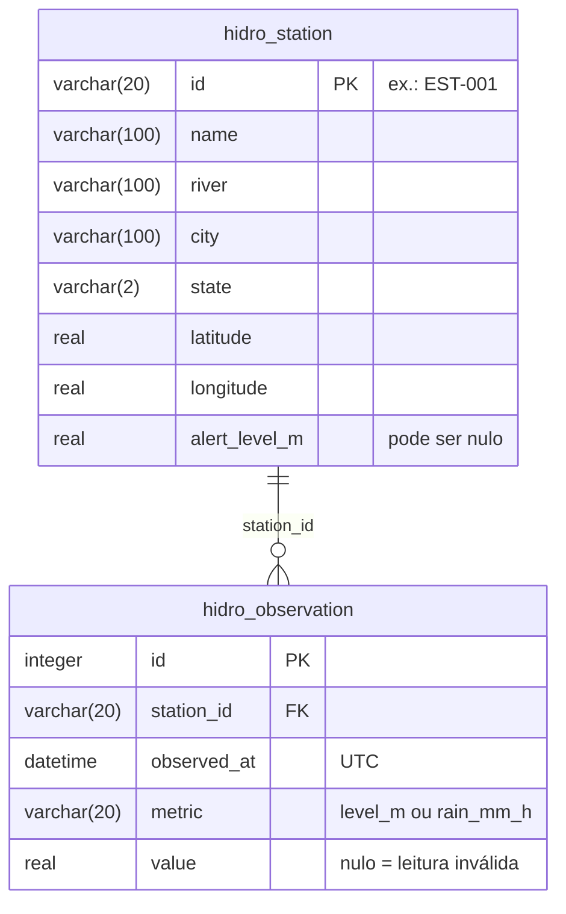

# Modelo de dados (MER e DER)

## MER (modelo conceitual)

- **Estação** (fictícia): tem um código, nome, rio, município, UF, coordenadas e um nível de alerta.
- **Leitura**: o valor de uma métrica (nível do rio ou chuva) medido em uma hora, em UTC.
- Relacionamento: uma **Estação** *registra* **0 ou mais** Leituras; cada Leitura pertence a **exatamente 1** Estação (1:N).

## DER (modelo físico, SQLite)

Regras:

- `(station_id, observed_at, metric)` é **único**: não existem duas leituras da mesma métrica na mesma hora.
- Índice em `(station_id, observed_at)` para deixar a consulta da série rápida.
- `metric` só aceita `level_m` (metros) e `rain_mm_h` (milímetros por hora).
- Valores inválidos no CSV (vazio, `NaN`, negativos como `-999`, texto) são gravados como `NULL`.
  Assim a série continua com todas as horas e a API devolve `null` naquele ponto.

## Arquivos CSV

`data/stations.csv`

| coluna | exemplo |
|---|---|
| id | EST-001 |
| name | Ponte Velha |
| river | Rio Aurora |
| city | Vale Verde |
| state | MG |
| latitude | -19.912 |
| longitude | -43.941 |
| alert_level_m | 4.5 |

`data/observations.csv` (formato "longo": uma linha por métrica)

| coluna | exemplo |
|---|---|
| station_id | EST-001 |
| observed_at | 2026-11-03T18:00:00Z |
| metric | level_m |
| value | 2.56 |
